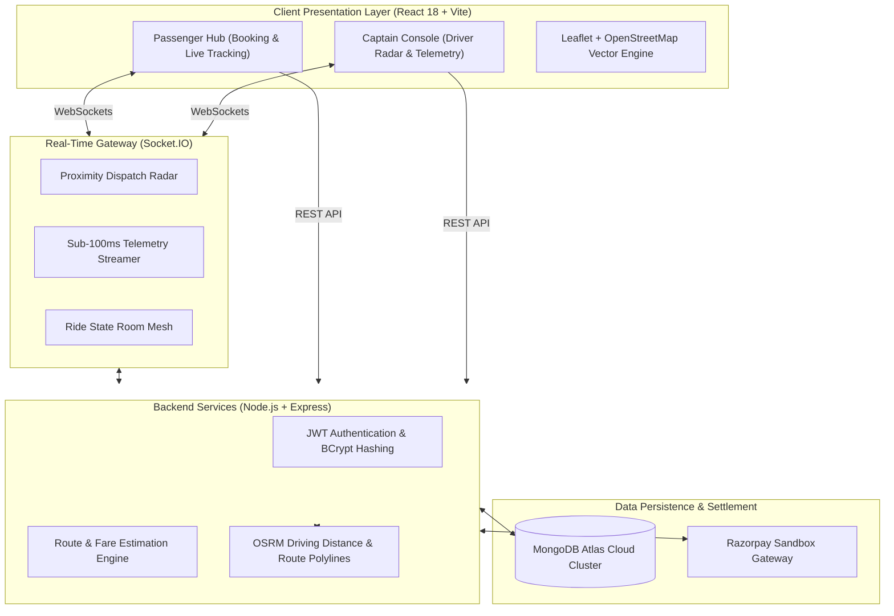

# Tripzy — Real-Time Micro-Mobility & Ride-Sharing Platform

[](https://tripzy-6xho.vercel.app/)
[](https://github.com/Suryacodeshere/Tripzy)
[](https://openstreetmap.org)
[](test_e2e_flow.js)
[](LICENSE)

> A production-grade, real-time urban ride-sharing platform engineered to tackle traffic congestion, ride cancellations, and expensive mapping overhead. Built with React 18, Node.js, Socket.IO WebSockets, and open-source GIS routing.

### 🌐 [**Experience the Live Demo**](https://tripzy-6xho.vercel.app/)

---

## ⚡ Engineering Highlights & Core Features

- **⚡ Sub-100ms Duplex Telemetry:** Bi-directional WebSockets via Socket.IO provide instantaneous driver radar broadcasts, real-time GPS coordinate streaming, and live car tracking on the map.
- **🗺️ Zero-Cost Open GIS Architecture:** Powered entirely by Leaflet.js and OpenStreetMap vector tiles paired with OSRM (Open Source Routing Machine). Zero dependency on paid, rate-limited Google Maps APIs.
- **🔐 Mutual 4-Digit Security Handshake:** Server generates a cryptographically signed 4-digit start PIN displayed only to the passenger. Drivers cannot start the trip meter without inputting this PIN, preventing wrong-car boardings and phantom rides.
- **🛵 Micro-Mobility First Architecture:** Custom pricing engine and first-class dispatch for **Bike Taxis (Moto)** and **Auto-Rickshaws (CNG)** alongside Sedans and SUVs, navigating dense traffic with low overhead.
- **🌱 Real-Time Carbon Offset Engine:** Dynamic calculations quantify the exact grams of CO₂ displaced for each vehicle tier compared to single-passenger private cars.
- **🔄 Surge Shield & Guaranteed Return Trips:** Pre-locks return trips at 0% surge for airport or suburban commuters while connecting with backhaul drivers to eliminate empty deadhead miles.
- **❄️ Upfront Comfort Agreement:** In-app selection of AC preference during booking eliminates driver haggling and sets crystal-clear expectations upfront.
- **🛡️ 1-Tap 112 Safety Shield:** Integrated non-reloading safety center with instant dialing to National Police Helpline (112) and continuous GPS satellite telemetry overlay.
- **📍 Smart Intra-City Geocoding Boundary:** Custom spatial filtering (< 75 km radius) strictly limits suggestions to local city boundaries with a high-contrast, accessible UI.
- **💳 Digital Sandbox Checkout:** Razorpay sandbox engine supporting UPI, Credit/Debit Cards, NetBanking, and Cash payment state transitions.

---

## 🏛️ System Architecture



---

## 🛠️ Technology Stack

| Layer | Technologies | Purpose |
|---|---|---|
| **Frontend** | React 18, Vite 5, SCSS/SASS | Component-driven SPA with instant hot-module replacement and dark-mode styling |
| **Mapping & GIS** | Leaflet.js 1.9, OpenStreetMap, OSRM API | High-DPI interactive maps, custom markers, and real road driving calculations |
| **Backend** | Node.js v20 LTS, Express.js | High-concurrency asynchronous RESTful API services |
| **Real-Time** | Socket.IO 4.7 | Full-duplex WebSocket event mesh for live driver telemetry and radar matching |
| **Database** | MongoDB Atlas, Mongoose ODM | Distributed cloud NoSQL document store with strict schema models |
| **Security** | JWT (JSON Web Tokens), BCrypt.js, 4-Digit OTP | Session management and mutual ride start handshake verification |
| **Payments** | Razorpay SDK (Sandbox) | Simulated digital payment processing (UPI, Card, Cash) |
| **DevOps & Cloud** | Vercel (Frontend), Render (Backend), GitHub Actions | Automated CI/CD deployment with global edge CDN caching |

---

## 📱 User Workflow

### Passenger Experience:
1. **Search:** Enter pickup and drop-off addresses with auto-suggest filtered strictly within 75 km.
2. **Select Tier:** Compare Bike Taxi, Auto, Sedan, or SUV with upfront fares and CO₂ displacement stats.
3. **Customize:** Toggle AC comfort preference or pre-lock a Guaranteed Return Ride.
4. **Security Handshake:** Receive a private 4-digit PIN upon driver assignment.
5. **Track & Pay:** Watch the driver approach live on the map and complete payment via Razorpay or Cash.

### Driver (Captain) Experience:
1. **Go Online:** One-click toggle connects the driver to the live dispatch radar mesh.
2. **Transparent Radar Alert:** Review pickup distance, drop-off destination, and estimated fare upfront.
3. **Accept & Route:** Accept the ride and follow turn-by-turn road routes to the pickup location.
4. **PIN Validation:** Enter the rider's 4-digit PIN to activate the trip meter (ride cannot start without it).
5. **Complete:** Arrive at the destination, finalize the ride, and collect payment.

---

## 🧪 Automated Testing Suite

Tripzy includes an end-to-end integration test runner simulating concurrent passenger bookings, WebSocket radar dispatches, 4-digit PIN verification, and trip completion:

```bash
# Run the automated 12-stage E2E simulation test
node test_e2e_flow.js
```

### Verified Test Matrix (100% Pass Rate):
- [x] Backend service health check
- [x] Passenger registration & JWT authentication
- [x] Driver registration & vehicle profile setup
- [x] Multi-tier route estimation (`/api/rides/estimate`) with CO₂ offset calculations
- [x] Socket.IO bi-directional WebSocket handshake
- [x] Driver availability status toggling (`driver-online`)
- [x] Passenger ride request creation (`POST /api/rides`)
- [x] Radar dispatch broadcast to nearby drivers
- [x] Driver ride acceptance event handling (`driver-accept-ride`)
- [x] Mutual 4-digit PIN validation and trip meter initiation (`POST /api/rides/:id/start`)
- [x] Real-time vehicle location telemetry broadcasting (`driver-location`)
- [x] Trip settlement and state finalization (`POST /api/rides/:id/complete`)

---

## 💻 Local Setup & Development

### Prerequisites
- Node.js (v18+)
- npm (v9+)
- MongoDB Atlas database URI or local MongoDB instance

### 1. Clone the Repository
```bash
git clone git@github.com:Suryacodeshere/Tripzy.git
cd "Ride Sharing"
```

### 2. Backend Setup
```bash
cd backend
npm install
```

Create a `.env` file in `backend/`:
```env
PORT=5000
MONGODB_URI=your_mongodb_atlas_connection_string
JWT_SECRET=your_jwt_secret_key
RAZORPAY_KEY_ID=your_razorpay_key_id
RAZORPAY_KEY_SECRET=your_razorpay_secret
```

Start the backend server:
```bash
npm run dev
# Server running at http://localhost:5000
```

### 3. Frontend Setup
```bash
cd ../frontend
npm install
```

Start the Vite development client:
```bash
npm run dev
# Client running at http://localhost:5173
```

---

## 📜 License
Distributed under the MIT License. See `LICENSE` for more information.
