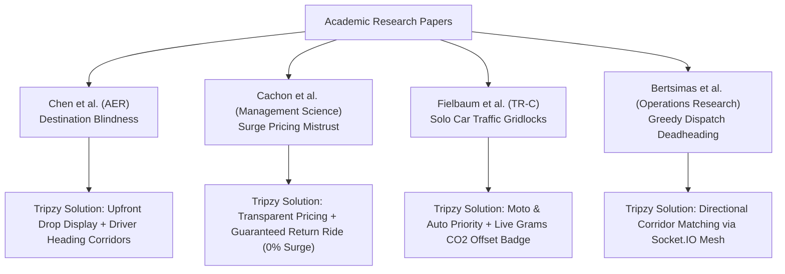
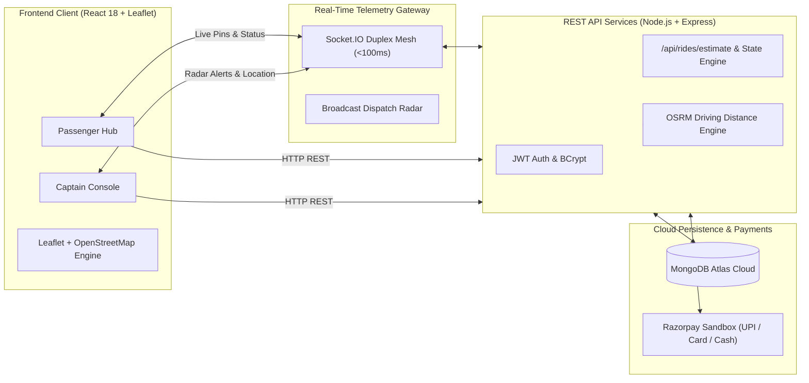

# Tripzy — Sustainable Real-Time Urban Ride-Sharing Platform

[](https://tripzy-6xho.vercel.app/)
[](https://tripzy-6e4q.onrender.com)
[](https://github.com/Suryacodeshere/Tripzy)
[](https://openstreetmap.org)
[](test_e2e_flow.js)

**Tripzy** is a next-generation urban ride-sharing web platform engineered specifically for the demands of high-density Indian metropolitan cities. Built on the full MERN stack with Socket.IO and OpenStreetMap, Tripzy solves the most frustrating problems in modern ride-hailing: **high driver cancellations, opaque surge pricing, traffic congestion, and security risks**.

---

## 🌐 Live Deployments & Presentation

- **Frontend Client (Vercel):** [https://tripzy-6xho.vercel.app/](https://tripzy-6xho.vercel.app/)
- **Backend API & WebSocket Gateway (Render):** [https://tripzy-6e4q.onrender.com](https://tripzy-6e4q.onrender.com)
- **Review 3 PowerPoint Presentation:** [`Tripzy_Review_3_Final.pptx`](Tripzy_Review_3_Final.pptx)

---

## 🚀 What Makes Tripzy Different? (Key Innovations)

Unlike conventional ride-hailing applications (Uber, Ola, Rapido), Tripzy addresses structural flaws identified through peer-reviewed transportation research:

| Innovation | The Problem in Existing Apps | How Tripzy Solves It |
|---|---|---|
| 🔐 **4-Digit Mutual Security PIN** | Passengers accidentally board wrong vehicles; drivers start trips without passengers. | Server generates a private 4-digit PIN for the passenger. The driver cannot start the trip meter or navigation without entering this exact code. |
| 🔄 **Guaranteed Return Ride (Surge Shield)** | Riders get stranded late at night or at airports with 3x surge pricing; drivers drive back empty. | Riders can pre-lock their return ride at **0% surge** with an incoming backhaul driver when booking their outbound trip. |
| ❄️ **Upfront AC Comfort Agreement** | Drivers refuse to turn on air conditioning in hot weather, causing heated arguments. | Passenger selects **AC On** or **AC Off** directly on the booking screen; clear expectations and transparent fare adjustments with zero haggling. |
| 🛵 **Micro-Mobility First (Bike & Auto)** | Solo-passenger private cars create inner-city traffic bottlenecks and high emissions. | Full first-class support for **Tripzy Moto (Bike Taxi)** and **Tripzy Auto (CNG)** alongside Sedans and SUVs, with upfront fares. |
| 🌱 **Real-Time Grams CO₂ Saved Badge** | Zero environmental awareness or incentives for choosing compact transit. | Dynamically computes and displays exact **grams of CO₂ displaced** on every ride card vs. a single-passenger private car. |
| 🛡️ **In-App 112 Safety Shield** | Emergency help is hidden deep inside menus or redirects out of the app. | Integrated 1-tap dialer to **112 (National Police Emergency)** with continuous live GPS satellite telemetry visible without leaving the map. |
| 🗺️ **Zero-Cost Open-Source Mapping** | Expensive Google Maps APIs break student/startup projects due to billing limits or expired keys. | 100% open-source GIS engine using **Leaflet.js** and official **OpenStreetMap** vector tiles, saving thousands in recurring API fees. |
| 📍 **Strict 75 km Intra-City Search Radius** | Search suggestions show irrelevant locations across the globe (e.g. Paris, France when in Delhi). | Custom geocoding boundary strictly filters suggestions to within 75 km of the user's city, with a clean, high-contrast light dropdown. |

---

## 📖 Research Foundations & Literature Synthesis

Tripzy bridges academic transportation economics with production full-stack engineering, directly implementing solutions for gaps identified in four key papers:



1. **Chen, Sheldon, & Kawano (*American Economic Review*):**
   - *Finding:* Withholding destinations from drivers causes 25%–35% cancellations because drivers call riders to ask *"Where are you going?"* and cancel unprofitable trips.
   - *Tripzy Implementation:* Complete upfront destination visibility on driver radar alerts + **Driver Heading Corridors** for shift-end return trips.
2. **Cachon, Daniels, & Lobel (*Management Science*):**
   - *Finding:* Unpredictable dynamic surge multipliers destroy customer trust and create severe driver earnings instability.
   - *Tripzy Implementation:* Transparent formula-based tariffs + **Guaranteed Return Ride** pre-locking at 0% surge.
3. **Fielbaum, Kucharski, & Cats (*Transportation Research Part C*):**
   - *Finding:* Solo-passenger car hailing worsens urban traffic by up to 18%; platforms must prioritize high-density micro-mobility.
   - *Tripzy Implementation:* Priority for **Tripzy Moto (Bike Taxi)** and **Tripzy Auto** with dynamic **Grams CO₂ Saved** badges.
4. **Bertsimas, Jaillet, & Martin (*Operations Research*):**
   - *Finding:* Greedy "nearest-car" dispatch algorithms waste fuel and create long deadhead miles where empty cars drive far across town.
   - *Tripzy Implementation:* **Directional Corridor Matching** and proximity filtering via Socket.IO.

---

## 🏗️ System Architecture & Data Flow



---

## 🛠️ Technology Stack

| Layer | Technologies Used | Purpose |
|---|---|---|
| **Frontend** | React 18, Vite 5, SCSS/SASS, HTML5 Geolocation | Ultra-fast single page application with modern dark-mode aesthetics |
| **GIS & Mapping** | Leaflet.js, OpenStreetMap Tiles, OSRM Routing Engine | 100% free road routing, geocoding, and polyline visualization without Google Maps API keys |
| **Backend** | Node.js v20 LTS, Express.js | High-throughput asynchronous RESTful API services |
| **Real-Time** | Socket.IO 4.7 | Duplex WebSocket mesh for radar broadcasts and live vehicle telemetry |
| **Database** | MongoDB Atlas, Mongoose ODM | Distributed cloud NoSQL document database with strict schema validation |
| **Security** | JWT (24h tokens), BCrypt.js, 4-Digit OTP | Session management and mutual physical ride-start verification |
| **Payments** | Razorpay SDK Sandbox | Digital simulated checkout supporting UPI, Credit/Debit Cards, NetBanking, and Cash |
| **Cloud Hosting** | Vercel (Edge CDN), Render Cloud, GitHub CI/CD | Fully automated zero-downtime deployment pipeline |

---

## 📱 How It Works (Step-by-Step)

### Passenger Experience:
1. **Search Locations:** Enter pickup and drop addresses; smart autocomplete restricts suggestions strictly within 75 km of your city.
2. **Choose Vehicle:** Select between **Tripzy Moto (Bike)**, **Auto**, **Sedan (Go)**, or **SUV (Premier)**, reviewing upfront fares and grams of CO₂ saved.
3. **Customize:** Opt for AC comfort or pre-lock a **Guaranteed Return Ride** at 0% surge.
4. **Receive 4-Digit Security PIN:** Upon booking, receive a private 4-digit PIN on screen.
5. **Live Tracking & Payment:** Watch the driver approach in real time on the interactive map; pay via Razorpay (UPI/Card) or Cash on trip completion.

### Captain (Driver) Experience:
1. **Go Online:** Switch availability status to Online in the Captain Console.
2. **Transparent Radar Alert:** Receive an incoming ride popup clearly displaying pickup distance, destination area, and estimated earnings.
3. **Accept & Navigate:** Accept the ride and follow real road directions to the pickup point.
4. **Enter Passenger PIN:** Ask passenger for their 4-digit PIN; the trip meter will **not** start without this validation.
5. **Complete Trip:** Navigate to drop-off, click Complete Trip, and collect fare.

---

## 🧪 Automated Testing & Verification

Tripzy includes a comprehensive automated integration test suite simulating concurrent passenger bookings, WebSocket radar dispatches, 4-digit PIN verification, and trip completion:

```bash
# Run the automated End-to-End simulation test
node test_e2e_flow.js
```

### Verified Test Stages (100% Passing):
- [x] Step 1: Health check on backend server
- [x] Step 2: Passenger registration & JWT authentication
- [x] Step 3: Driver registration & vehicle profile setup
- [x] Step 4: Route estimation (`/api/rides/estimate`) with 4 vehicle tiers & CO₂ calculations
- [x] Step 5: Socket.IO duplex WebSocket connection for passenger and driver
- [x] Step 6: Driver availability toggle (`driver-online`)
- [x] Step 7: Passenger ride request creation (`POST /api/rides`)
- [x] Step 8: Radar alert broadcast and socket reception
- [x] Step 9: Driver ride acceptance (`driver-accept-ride`)
- [x] Step 10: 4-Digit Security PIN validation and trip start (`POST /api/rides/:id/start`)
- [x] Step 11: Real-time driver location telemetry streaming (`driver-location`)
- [x] Step 12: Trip completion and payment settlement (`POST /api/rides/:id/complete`)

---

## 💻 Local Installation & Setup

### Prerequisites
- Node.js (v18.0 or higher)
- npm (v9.0 or higher)
- MongoDB Atlas cluster URI or local MongoDB instance

### 1. Clone the Repository
```bash
git clone git@github.com:Suryacodeshere/Tripzy.git
cd "Ride Sharing"
```

### 2. Backend Setup
```bash
cd backend
npm install
```

Create a `.env` file in `backend/`:
```env
PORT=5000
MONGODB_URI=your_mongodb_atlas_connection_string
JWT_SECRET=your_super_secret_jwt_key
RAZORPAY_KEY_ID=rzp_test_your_key_id
RAZORPAY_KEY_SECRET=your_key_secret
```

Start the backend development server:
```bash
npm run dev
# Server runs on http://localhost:5000
```

### 3. Frontend Setup
```bash
cd ../frontend
npm install
```

Start the frontend development server:
```bash
npm run dev
# Client runs on http://localhost:5173
```

---

## 👥 Capstone Project Information

- **Project:** Tripzy — Real-Time Sustainable Ride-Sharing Platform
- **Review Stage:** Project Review 3 (Literature Synthesis, System Implementation & Testing)
- **Course:** Final Year Engineering Capstone Design Project
- **Department:** Department of Computer Science & Engineering
- **Team:** Group 12

---

## 📜 License
Distributed under the MIT License. Developed for educational and research evaluation.
